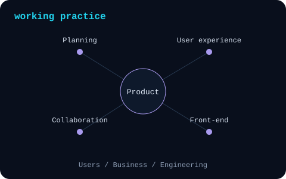
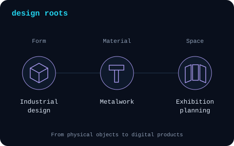

<picture>
  <source media="(prefers-color-scheme: dark)" srcset="assets/banner-dark.svg">
  <source media="(prefers-color-scheme: light)" srcset="assets/banner-light.svg">
  
</picture>

 

# Eden Chang

`Technical Product Manager / Curious builder`

<table>
<tr>
<td width="50%" align="center">
<picture>
  <source media="(prefers-color-scheme: dark)" srcset="assets/signals-dark.svg">
  <source media="(prefers-color-scheme: light)" srcset="assets/signals-light.svg">
  
</picture>
</td>
<td width="50%" align="center">
<picture>
  <source media="(prefers-color-scheme: dark)" srcset="assets/roots-dark.svg">
  <source media="(prefers-color-scheme: light)" srcset="assets/roots-light.svg">
  
</picture>
</td>
</tr>
</table>

---

`Curious builder / @eden0118`

