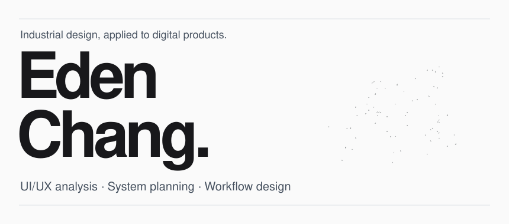
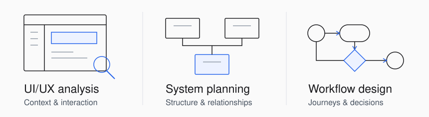

<picture>
  <source media="(prefers-color-scheme: dark)" srcset="./assets/design-cover-dark.svg" />
  <source media="(prefers-color-scheme: light)" srcset="./assets/design-cover.svg" />
  
</picture>

### Tech Product Manager

從**工業設計**出發，關注人如何理解、使用與體驗產品。 
擅長 **UI/UX 分析、系統規劃與流程設計**，讓產品體驗與背後的系統邏輯彼此對齊。

 

<picture>
  <source media="(prefers-color-scheme: dark)" srcset="./assets/design-practice-dark.svg" />
  <source media="(prefers-color-scheme: light)" srcset="./assets/design-practice.svg" />
  
</picture>

### 設計與產品

- **UI/UX 分析** — 從使用情境、資訊層級與互動細節，找出體驗中的問題。
- **系統規劃** — 釐清需求、功能與相依關係，建立清楚的產品結構。
- **流程設計** — 串起使用者旅程與系統行為，讓每個步驟有合理的目的。

 

[瀏覽我的 GitHub 專案](https://github.com/eden0118?tab=repositories)

---

GitHub activity

 

<picture>
  <source media="(prefers-color-scheme: dark)" srcset="./assets/contributions-dark.svg" />
  <source media="(prefers-color-scheme: light)" srcset="./assets/contributions.svg" />
  
</picture>

<picture>
  <source media="(prefers-color-scheme: dark)" srcset="./assets/stats-dark.svg" />
  <source media="(prefers-color-scheme: light)" srcset="./assets/stats.svg" />
  
</picture>

