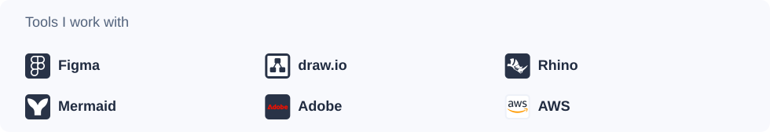

<picture>
  <source media="(max-width: 440px) and (prefers-reduced-motion: reduce) and (prefers-color-scheme: dark)" srcset="assets/banner-static-mobile-dark.svg">
  <source media="(max-width: 440px) and (prefers-reduced-motion: reduce)" srcset="assets/banner-static-mobile-light.svg">
  <source media="(max-width: 440px) and (prefers-color-scheme: dark)" srcset="assets/banner-mobile-dark.svg">
  <source media="(max-width: 440px)" srcset="assets/banner-mobile-light.svg">
  <source media="(max-width: 899px) and (prefers-reduced-motion: reduce) and (prefers-color-scheme: dark)" srcset="assets/banner-static-tablet-dark.svg">
  <source media="(max-width: 899px) and (prefers-reduced-motion: reduce)" srcset="assets/banner-static-tablet-light.svg">
  <source media="(max-width: 899px) and (prefers-color-scheme: dark)" srcset="assets/banner-tablet-dark.svg">
  <source media="(max-width: 899px)" srcset="assets/banner-tablet-light.svg">
  <source media="(prefers-reduced-motion: reduce) and (prefers-color-scheme: dark)" srcset="assets/banner-static-dark.svg">
  <source media="(prefers-reduced-motion: reduce)" srcset="assets/banner-static-light.svg">
  <source media="(prefers-color-scheme: dark)" srcset="assets/banner-dark.svg">
  
</picture>

<picture>
  <source media="(max-width: 440px) and (prefers-color-scheme: dark)" srcset="assets/experience-mobile-dark.svg">
  <source media="(max-width: 440px)" srcset="assets/experience-mobile-light.svg">
  <source media="(max-width: 899px) and (prefers-color-scheme: dark)" srcset="assets/experience-tablet-dark.svg">
  <source media="(max-width: 899px)" srcset="assets/experience-tablet-light.svg">
  <source media="(prefers-color-scheme: dark)" srcset="assets/experience-dark.svg">
  
</picture>

<picture>
  <source media="(max-width: 440px) and (prefers-color-scheme: dark)" srcset="assets/perspective-mobile-dark.svg">
  <source media="(max-width: 440px)" srcset="assets/perspective-mobile-light.svg">
  <source media="(max-width: 899px) and (prefers-color-scheme: dark)" srcset="assets/perspective-tablet-dark.svg">
  <source media="(max-width: 899px)" srcset="assets/perspective-tablet-light.svg">
  <source media="(prefers-color-scheme: dark)" srcset="assets/perspective-dark.svg">
  
</picture>

<picture>
  <source media="(max-width: 440px) and (prefers-color-scheme: dark)" srcset="assets/toolkit-mobile-dark.svg">
  <source media="(max-width: 440px)" srcset="assets/toolkit-mobile-light.svg">
  <source media="(max-width: 899px) and (prefers-color-scheme: dark)" srcset="assets/toolkit-tablet-dark.svg">
  <source media="(max-width: 899px)" srcset="assets/toolkit-tablet-light.svg">
  <source media="(prefers-color-scheme: dark)" srcset="assets/toolkit-dark.svg">
  
</picture>
