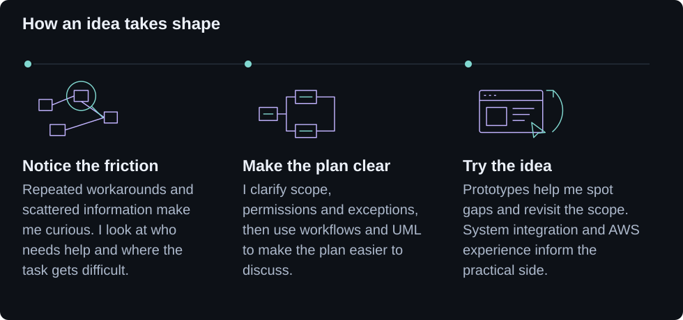
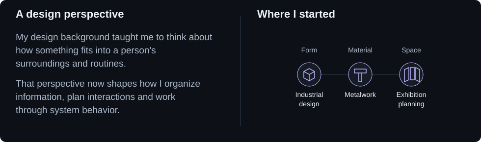

<picture>
  <source media="(max-width: 600px) and (prefers-reduced-motion: reduce) and (prefers-color-scheme: dark)" srcset="assets/banner-static-mobile-dark.svg">
  <source media="(max-width: 600px) and (prefers-reduced-motion: reduce)" srcset="assets/banner-static-mobile-light.svg">
  <source media="(prefers-reduced-motion: reduce) and (prefers-color-scheme: dark)" srcset="assets/banner-static-dark.svg">
  <source media="(prefers-reduced-motion: reduce)" srcset="assets/banner-static-light.svg">
  <source media="(max-width: 600px) and (prefers-color-scheme: dark)" srcset="assets/banner-mobile-dark.svg">
  <source media="(max-width: 600px)" srcset="assets/banner-mobile-light.svg">
  <source media="(prefers-color-scheme: dark)" srcset="assets/banner-dark.svg">
  <source media="(prefers-color-scheme: light)" srcset="assets/banner-light.svg">
  
</picture>

<picture>
  <source media="(max-width: 600px) and (prefers-color-scheme: dark)" srcset="assets/experience-mobile-dark.svg">
  <source media="(max-width: 600px)" srcset="assets/experience-mobile-light.svg">
  <source media="(prefers-color-scheme: dark)" srcset="assets/experience-dark.svg">
  <source media="(prefers-color-scheme: light)" srcset="assets/experience-light.svg">
  
</picture>

<picture>
  <source media="(max-width: 600px) and (prefers-color-scheme: dark)" srcset="assets/perspective-mobile-dark.svg">
  <source media="(max-width: 600px)" srcset="assets/perspective-mobile-light.svg">
  <source media="(prefers-color-scheme: dark)" srcset="assets/perspective-dark.svg">
  <source media="(prefers-color-scheme: light)" srcset="assets/perspective-light.svg">
  
</picture>

 
 

  
  
  

  
  
  
  

