<picture>
  <source media="(prefers-color-scheme: dark)" srcset="./assets/design-cover-dark.svg" />
  <source media="(prefers-color-scheme: light)" srcset="./assets/design-cover.svg" />
  
</picture>

Industrial design, metalwork, and exhibition planning shaped how I approach product work.

<picture>
  <source media="(prefers-color-scheme: dark)" srcset="./assets/practice-workflow-dark.svg" />
  <source media="(prefers-color-scheme: light)" srcset="./assets/practice-workflow.svg" />
  
</picture>
