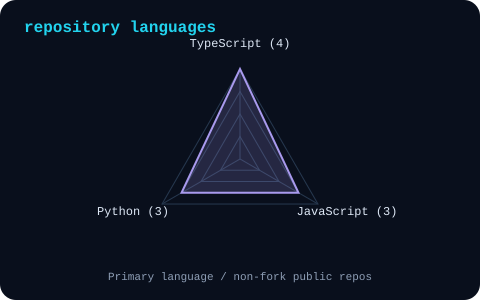

<picture>
  <source media="(prefers-color-scheme: dark)" srcset="assets/banner-dark.svg">
  <source media="(prefers-color-scheme: light)" srcset="assets/banner-light.svg">
  
</picture>

 

# Eden Chang

`Technical Product Manager / Curious builder`

 

---

## This is me :)

Hi, I'm **Eden**, a technical product manager with a background in
**industrial design, metalwork and exhibition planning**.
I connect product planning, user experience and front-end implementation.

- **Planning:** turn loose requirements into a clear product structure.
- **User experience:** connect interface screens with the actions people take.
- **Collaboration:** bring users, business and engineering into a shared plan.
- **Front-end:** connect interface decisions with implementation.

 

## my working stack

---

## signals

<table>
<tr>
<td width="50%" align="center">
<picture>
  <source media="(prefers-color-scheme: dark)" srcset="assets/signals-dark.svg">
  <source media="(prefers-color-scheme: light)" srcset="assets/signals-light.svg">
  
</picture>
</td>
<td width="50%" align="center">
<picture>
  <source media="(prefers-color-scheme: dark)" srcset="assets/languages-dark.svg">
  <source media="(prefers-color-scheme: light)" srcset="assets/languages-light.svg">
  
</picture>
</td>
</tr>
</table>

---

## a few numbers

<picture>
  <source media="(prefers-color-scheme: dark)" srcset="assets/stats-dark.svg">
  <source media="(prefers-color-scheme: light)" srcset="assets/stats-light.svg">
  
</picture>

---

` Curious builder / @eden0118 `

