<picture>
  <source media="(prefers-color-scheme: dark)" srcset="./assets/design-cover-dark.svg" />
  <source media="(prefers-color-scheme: light)" srcset="./assets/design-cover.svg" />
  
</picture>

 

### About

I'm Eden, a Tech Product Manager with a background in industrial design. I focus on UI/UX analysis, system planning, and workflow design, and contribute directly to front-end implementation.

My training in metalwork and industrial design informs how I approach structure, assembly sequences, and practical constraints. I translate fragmented requirements into information architecture and task flows, clarifying how features connect and what the team needs to build.

#### Requirements and information architecture

I clarify user contexts, business needs, and technical constraints before defining feature relationships and information architecture. I also account for maintenance and future changes, so new requirements can fit into the existing structure.

<picture>
  <source media="(prefers-color-scheme: dark)" srcset="./assets/practice-structure-dark.svg" />
  <source media="(prefers-color-scheme: light)" srcset="./assets/practice-structure.svg" />
  
</picture>

#### UI/UX and task flows

I evaluate interfaces in the context of complete tasks: the order in which information appears, the actions users take, and the transitions between screens and states. My experience in curation and exhibition planning informs how I think about movement, attention, and information hierarchy.

<picture>
  <source media="(prefers-color-scheme: dark)" srcset="./assets/practice-journey-dark.svg" />
  <source media="(prefers-color-scheme: light)" srcset="./assets/practice-journey.svg" />
  
</picture>

#### Cross-functional alignment

In curatorial work, I coordinated sponsors, artists, and venue technicians under resource constraints. I bring that experience to product discussions, making competing priorities and technical trade-offs explicit so teams can agree on a workable plan.

<picture>
  <source media="(prefers-color-scheme: dark)" srcset="./assets/practice-alignment-dark.svg" />
  <source media="(prefers-color-scheme: light)" srcset="./assets/practice-alignment.svg" />
  
</picture>

#### Design and implementation

I contribute directly to front-end implementation, translating product decisions into components, interface states, and constraints. I document the reasoning behind design and technical choices, giving the team a shared reference during review and handoff.

<picture>
  <source media="(prefers-color-scheme: dark)" srcset="./assets/practice-delivery-dark.svg" />
  <source media="(prefers-color-scheme: light)" srcset="./assets/practice-delivery.svg" />
  
</picture>
